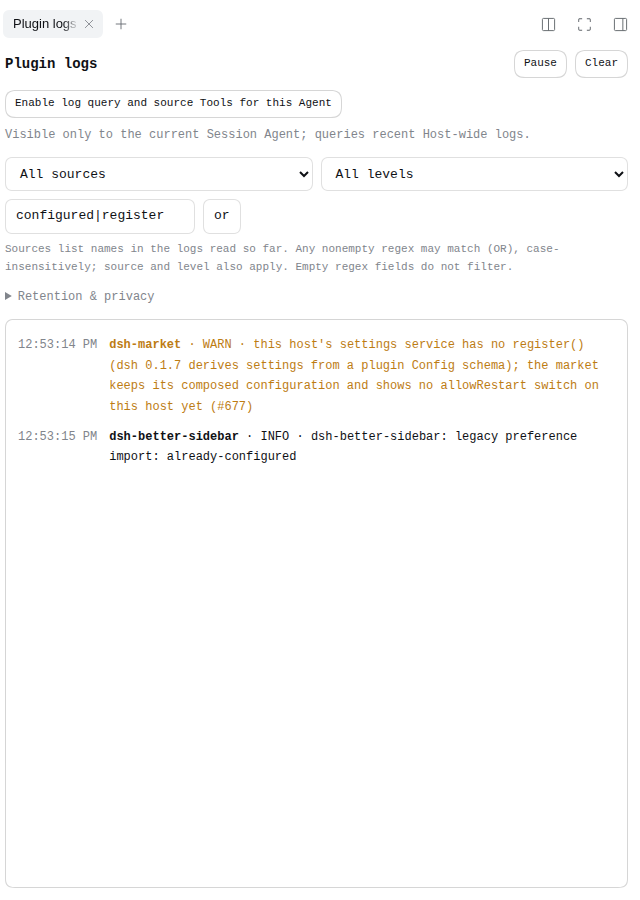
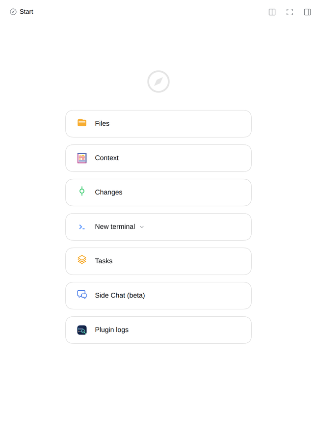

# Plugin Logs

View Host runtime logs in the DSH right sidebar: filter by source and level, search with multiple regex conditions (any match), pause/resume or clear the current list, and optionally let the current Agent query recent logs. Logs live in Host memory only and are never written to disk.

[中文](./README.md)

## Interface



Captured from the DSH `0.2.0-rc.2` Web UI in Chrome 150 on Linux. Source, level, and regex conditions sit above the log list; *Pause / Clear* and *Enable log query and source Tools for this Agent* control reading and Agent access.

## When to use

- Debug Cordis `ctx.logger` output produced on the Host side by a DSH plugin, service, or tool.
- Inspect recent records while reproducing an issue, or let the current Agent search logs temporarily.
- It does not collect the browser console, install output, custom log files, or past sessions, and it is not an inventory of installed plugins.

## Install

Requires DSH `0.2.0-rc.2` or `0.2.1-rc.1`. Installing the prebuilt package needs neither Node.js nor TypeScript.

Install the v1.0.0 prebuilt package:

```sh
dsh plugin --profile web add https://github.com/lemonel/dsh-plugin-logs/releases/download/v1.0.0/lemonel-dsh-plugin-logs-1.0.0.tgz
```

Replace `web` with your profile. Confirm `@lemonel/dsh-plugin-logs` is enabled as a bundle (its Loader entry ID is `lemonel-plugin-logs`), then follow the DSH prompt to reload the backend and refresh the page. You can also download the tgz and install it from a local file on the DSH Plugins page.

Building from source requires Node.js 22:

```sh
git clone https://github.com/lemonel/dsh-plugin-logs.git
cd dsh-plugin-logs
npm ci --prefer-offline --no-audit --no-fund
npm run build
dsh plugin --profile web add "$PWD"
```

Link local dependencies at the package root, not at `lib/`. Building or packing does not install the plugin, restart the Host, or update pages that are already open. Install and reload through DSH management; do not edit a running profile by hand.

## Usage

The entry is on the right-sidebar guide page:



1. Open the right sidebar and choose *Plugin logs* on the guide page.
2. *Log source* lists logger names present in the current list (usually containing a plugin or service name) and filters by exact name; *All sources* does not filter. A selected source stays in the list and is marked as having no records when it leaves the current window.
3. *Log level* intersects with the source and search conditions.
4. Add multiple nonempty regex conditions: any one may match (OR), case-insensitively; at most 8 conditions, 200 characters each. Empty conditions do not restrict text.
5. *Pause* stops reading; *Resume* continues from the same cursor and reports unread records overwritten in the Host buffer. *Clear* clears only this browser's list; it does not delete the Host buffer or reload old records.
6. To let the Agent query logs, use the Tool toggle in the panel (next section).

Regex runs only in a dedicated Worker and is terminated after a 500 ms timeout. Without Worker support, or when CSP blocks Blob Workers, a nonempty regex fails closed; it never falls back to the main thread. After a timeout, edit the expression and retry; the same conditions are not rerun automatically as new logs arrive.

The UI follows the DSH Chinese/English locale setting; languages DSH does not provide fall back through the Host locale service. Log text, logger names, and level labels are not translated.

## Agent tools

The panel toggle applies only to the **current top-level Session Agent** and is off by default. When enabled, it registers two Tools for that Agent:

- `plugin_logs_query`: queries newest first by `source`, `text`, `level`, and `limit` (default 20, maximum 50). `source` and `text` are case-insensitive literal substrings, not regex; `|` separates alternatives, and each filter is at most 120 characters.
- `plugin_logs_sources`: returns logger sources observed in the current buffer (up to 200) with retained counts, latest record time, the total count, and a truncation flag.

The toggle affects the next model request. Subagents cannot enable it and do not inherit the Tool. Registrations are cleaned up when the Agent is disposed or the plugin is unloaded; panels for the same page and Session synchronize every 2 seconds and on focus.

`plugin_logs_sources` is not an installed-plugin inventory: silent sources and sources whose logs have expired do not appear.

## Data and privacy

- Logs live in Host memory only. The Host keeps the latest 2000 records by default (`capacity` can be set to 1–10000), and the browser keeps the latest 2000; nothing is written to disk, records emitted before the plugin was enabled are not backfilled, and reloading the plugin or restarting the Host clears the buffer.
- Full pages are fetched immediately; after four consecutive pages the poller yields for 16 ms, and it polls every 1200 ms once caught up. Lossless retention is not guaranteed at arbitrary log rates. The Remote has no cancellation API; late responses after pause, unload, or reload are dropped.
- Text and source are capped at 4096 and 160 UTF-16 code units per record, respectively. Formatting reads at most 32 arguments, probes 64 properties, recurses 3 levels, and visits 20 array items; it does not run getters or custom inspect/toJSON, and does not enumerate arbitrary object keys. Other business fields may be omitted as `…`, and a native Error's lazy stack is not evaluated.
- **Logs are not redacted and may contain credentials, paths, configuration, or prompts.** Use only with trusted Web users. Agent scope controls Tool visibility and the execution target, not remote-user authorization; reading the tail returns Host-wide logs.

## Compatibility

| Item | Status |
| --- | --- |
| DSH `0.2.0-rc.2` | Pass; Linux x64, Node.js 22, isolated install, full build and tests |
| DSH `0.2.1-rc.1` | Pass; Linux x64, Node.js 22, isolated install, full build and tests |
| Linux x64 | Tested natively |
| Linux arm64 / other architectures | Not tested |
| Node.js 22 | Used for build and tests |
| Other Node.js versions | Not tested |
| Native Windows / macOS | Not tested |
| Real browser | Chrome 150 (Linux, headless) loaded a real DSH Web instance for this screenshot and filtering; desktop, cross-platform, and full interaction acceptance are not covered |

Host packages are declared as `peerDependencies` restricted to the two DSH prerelease ranges above; DSH disables the plugin on a mismatch. Regex search also requires a browser with Worker and Blob URL support. A headless screenshot is not acceptance for desktop environments or every browser.

## Development

Licensed under [MIT](./LICENSE), authored by lemonel. GitHub CI verifies both DSH versions on branch pushes, PRs, and manual runs. A `v*` tag triggers Release: it reuses the full CI, then packs, validates, and uploads the tgz and SHA-256 checksum. Only the publishing job has repository write permission and uses the built-in Actions token; no personal token or npm secret is needed. It does not publish to npm (`private: true` prevents accidental npm publication). See the [release checklist](./RELEASING.md).

```sh
npm ci --prefer-offline --no-audit --no-fund
npm run typecheck
npm run build
npm test
npm run check:package
npm run check:clean
npm run check:compat
```

- Business sources use strict TypeScript: entries are `src/backend_index.ts` and `src/frontend_index.ts`, implementations live under `src/backend/` and `src/frontend/`, and `src/shared/` contains only protocols, RPC contracts, and boundary validation shared by both ends. Handwritten build and test scripts remain JavaScript.
- `npm run build` type-checks first, then cleans and rebuilds the ignored `lib/`. The frontend is bundled by esbuild from the dependency graph into a ModuleLoader bundle, and RPC descriptors reference real artifacts. Do not commit or edit `lib/`; build before installing a local link. Package entries need no TypeScript loader.
- Test helpers live in `test/tools/`. `check:clean` runs a lockfile install, typecheck, full build, all tests, and an actual tgz inspection from an independent source copy; `check:compat` repeats that for both supported DSH versions, generating a lockfile in the copy for the alternate version before continuing with `npm ci`. Dependencies must resolve locally in the copy; a missing dependency fails instead of falling back to a global installation, and no `--force` or `--legacy-peer-deps` is used.
- The package configuration includes `lib/`, `bundles/plugin-logs.patch.yml`, `icon.svg`, both READMEs, the release checklist, the `docs/` screenshots, `screenshots.json`, the MIT `LICENSE`, and `package.json`; `prepack` builds automatically. The bundle configuration is referenced explicitly by `dsh.bundle.patch`.
- When the UI or user-facing copy changes, retake `docs/panel-zh.png` and `docs/panel-en.png`, keep both images current, and make sure they contain no personal paths, credentials, or other sensitive data; `screenshots.json` lists the screenshots used for market display.
- Slots, the Remote, Workers, timers, and event listeners are cleaned up when the plugin or component is disposed. Reloading the plugin clears the Host buffer, and the page must be refreshed to re-establish the tail. Changes involving the Host entry or Remote identity usually require a backend reload; HMR alone is not enough. Reviews and tests cover lifecycle cleanup, but desktop manual interaction and cross-platform acceptance are not complete.
